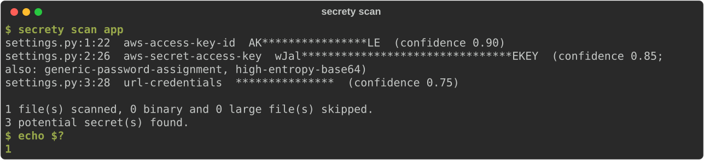
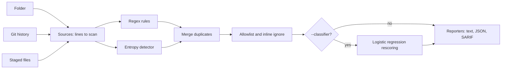

# secrety

Scan source code and Git history for exposed secrets (API keys, tokens,
passwords, private keys), with a confidence score for each finding.



## Why

A secret committed once is a secret leaked, even if the line is deleted in the
next commit: it stays in the history.

- **Toyota (2022).** A subcontractor published part of the T-Connect source
  code, with a hardcoded access key to a customer data server, in a public
  GitHub repository in December 2017. It stayed visible for about five years
  and gave access to the email addresses of 296,019 customers
  ([TechCrunch](https://techcrunch.com/2022/10/12/toyota-customer-email-addresses-exposed/),
  [GitGuardian](https://blog.gitguardian.com/toyota-accidently-exposed-a-secret-key-publicly-on-github-for-five-years/)).
  Toyota could not say whether anyone used the key.
- **Uber (2016).** Attackers found AWS credentials in a private GitHub
  repository used by Uber's engineers, and used them to reach an archive of
  data on 57 million riders and drivers
  ([Dark Reading](https://www.darkreading.com/attacks-breaches/uber-paid-hackers-$100k-to-conceal-2016-data-breach/d/d-id/1330487)).
- **At scale.** GitGuardian counted 12.8 million new secrets in public GitHub
  commits in 2023, up 28% from 2022
  ([report](https://blog.gitguardian.com/the-state-of-secrets-sprawl-2024/)).

secrety is a small, readable scanner built to learn how this detection works
and to measure honestly what it gets right and wrong. It is not a replacement
for [gitleaks](https://github.com/gitleaks/gitleaks) or
[trufflehog](https://github.com/trufflesecurity/trufflehog); the comparison is
below.

## Install

Python 3.11 or newer. secrety is not on PyPI yet; install it from GitHub:

```bash
pipx install git+https://github.com/Nakken13/secrety
secrety --version
```

For development:

```bash
git clone https://github.com/Nakken13/secrety
cd secrety
pip install -e ".[dev]"      # add ",eval" to rerun the evaluation
```

## Usage

```bash
secrety                                 # interactive menu (banner, numbered choices)
```

The menu walks you through folder, Git-history and staged scans, shows findings as cards per file
(secrets masked) and can save a text, JSON or SARIF report.

### Interactive menu walkthrough

1. **Launch**: run `secrety` with no arguments. The banner and the **Scan mode** menu appear.
2. **Pick a mode** by typing its number, then ENTER:
   - `1` Folder or file: scan files on disk.
   - `2` Git history: scan every line ever added in the repo.
   - `3` Staged changes: scan only what is staged (pre-commit check).
   - `0` About: short description of the tool, then back to the menu.
   - `q` Quit.
3. **Answer the prompts**:
   - `Path`: folder or file to scan; ENTER keeps the default `.` (current directory).
   - Git history only, `Newest commits to scan`: a whole number, or ENTER for the full history.
4. **Read the results**: findings are shown as cards grouped by file, with the secret masked,
   followed by a summary (files scanned, binary and large files skipped). A bad path or a
   non-repo folder shows an error and returns you to the menu.
5. **"What now?" submenu**:
   - `1` Save a report: choose Text, JSON or SARIF, then give an output file name. An existing
     file is never overwritten.
   - `2` New scan in the same mode.
   - `q` Back to the main menu.

The menu uses the default rules and detectors. For CI and fine-tuning use `scan`:

```bash
secrety scan .                          # files on disk
secrety scan . --git                    # every line ever added, all commits reachable from HEAD
secrety scan . --git --max-commits 200  # only the 200 newest commits
secrety scan --staged                   # only what is staged (pre-commit)
secrety scan . --classifier             # drop likely false positives (see Results)
secrety scan . -f sarif -o secrety.sarif    # report for GitHub code scanning
secrety scan . -f json                  # machine-readable, schema in tests/schemas/
secrety scan . --exit-zero              # report only, never fail the job
```

Exit code: `0` nothing found, `1` secrets found, `2` error. Secrets are always
masked in every output format. Run `secrety scan --help` for every option.

False positives: a `.secrety.toml` allowlist, an inline `secrety:ignore`
comment and custom rules (`--rules`) are described in
[docs/methodology.md](docs/methodology.md#reducing-false-positives). Use in
pre-commit and GitHub Actions: [docs/integration.md](docs/integration.md).

## How it works



- **Regex rules** match known formats (AWS, GitHub, Stripe, Google, Slack,
  JWT, private keys, URL credentials, password assignments).
- **Entropy** finds random-looking tokens that no rule knows, with separate
  thresholds for base64 and hex characters.
- **Classifier** (opt-in) is a logistic regression trained on a synthetic
  corpus. It reads features of the value, of the name it is assigned to and of
  the file type. It is stored as JSON and evaluated in pure Python: no pickle,
  no scikit-learn at runtime.

Details and the reasoning behind each threshold:
[docs/methodology.md](docs/methodology.md).

## Results

Measured on a held-out synthetic corpus (14 file formats, 11 secret families,
12 families of look-alike decoys), generated from a fixed seed. Full tables,
plots and how to reproduce: [docs/results/](docs/results/README.md).

| Configuration | Precision | Recall | F1 |
| --- | ---: | ---: | ---: |
| regex only | 0.851 | 0.905 | 0.877 |
| entropy only | 0.590 | 0.696 | 0.639 |
| regex + entropy | 0.608 | 0.995 | 0.755 |
| regex + entropy + classifier | 0.909 | 0.925 | 0.917 |
| gitleaks 8.30.1 | 0.940 | 0.741 | 0.829 |
| trufflehog 3.100.0 (no verification) | 1.000 | 0.375 | 0.546 |

What this says: the classifier removes most of the false positives that
entropy creates (SHAs, checksums, placeholders, digests) at a small cost in
recall. What it does **not** say: that secrety beats gitleaks or trufflehog.
The corpus is generated by the same author as the detector, so the numbers
rank the configurations against each other; they do not predict the false
positive rate on your repository. Trufflehog without verification is
conservative by design. On 1,500 files secrety took 2.55 s, gitleaks 1.38 s
and trufflehog 1.79 s.

## Limits

- Synthetic evaluation only; no real-repository ground truth yet.
- Short secrets are invisible to entropy; the classifier can drop a real
  token it takes for a decoy (a marked fake like `ghp_FAKE...` is dropped on
  purpose). Use `--classifier` for triage, not as a gate.
- Scanning is line by line: a secret split over several lines is missed or
  seen in pieces.
- Public look-alikes remain (SSH public keys, some asset names). Lockfiles and
  test folders are allowlisted by default, so a real secret committed there is
  only counted, not reported.
- No check of whether a secret is still live.

The full list is in
[docs/methodology.md](docs/methodology.md#known-weaknesses).

## Future work

Real-repository evaluation with hand-labelled findings; secret verification
against the provider; multi-line detection; a PyPI release.

## Ethics

secrety is a defensive tool. Use it on code you own or are allowed to audit.
Findings are masked, and the fingerprint leaves out the secret and the line
number on purpose. A committed secret must be treated as compromised: rotate
it first, then clean the history. All secrets in the corpus, tests and demo
are fake. To report a vulnerability in secrety itself, see
[SECURITY.md](SECURITY.md).

## License

MIT, see [LICENSE](LICENSE).
